

# 📻 مذياع أنا المسلم

**إذاعات القرآن الكريم والعلوم الشرعية — المصحف الشريف — أوقات الصلاة والقبلة — الأذكار**

تطوير **أبو عبدالله الشامي**

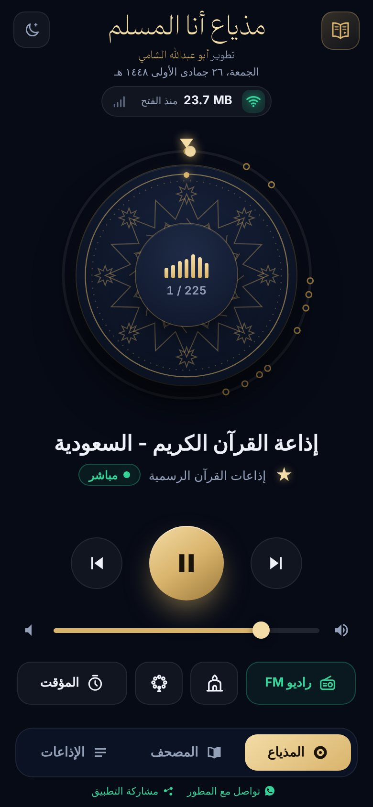&nbsp;
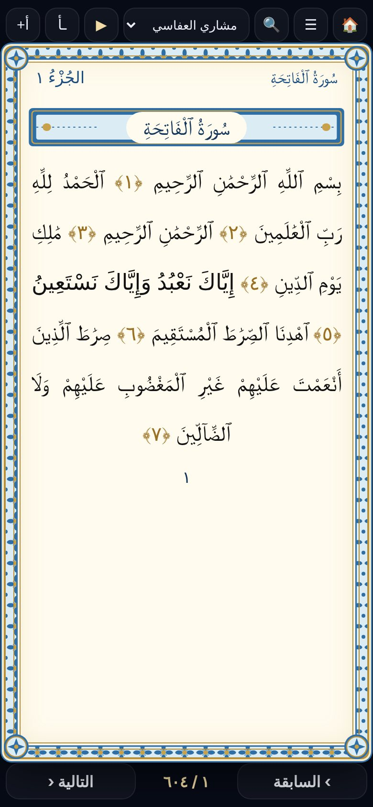&nbsp;
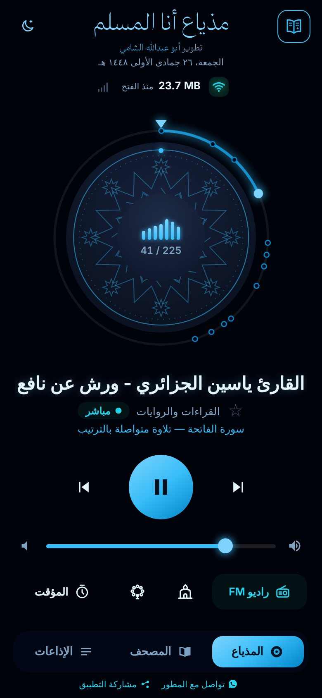

---

## ✨ المزايا

### 📻 المذياع
- **225 إذاعة** بث مباشر مرتّبة في تصنيفات: إذاعات القرآن الرسمية (السعودية، مصر، لبنان، الكويت، الإمارات، الجزائر، المغرب، تونس، فلسطين، الأردن، قطر، السودان…)، القراءات السبع ورواياتها، التفسير، الحديث، السيرة، دروس ومحاضرات المشايخ، العلوم الشرعية، الأذكار والرقية، إذاعات إسلامية حول العالم، و124 قارئاً.
- **قرص دوّار** على طراز المذياع الكلاسيكي: أدِره للانتقال بين الإذاعات.
- **أعمدة صوت حقيقية** تتحرك مع الصوت الفعلي وتهدأ عند السكوت.
- **⭐ المفضلة** في قسم خاص يظهر أولاً.
- **فحص الروابط**: يكتب تحت كل إذاعة «يعمل — يبث» أو «لا يعمل».
- **تشغيل في الخلفية** مع إشعار وأزرار التحكم على شاشة القفل.
- **مؤقت الإيقاف** (15 / 30 / 60 / 90 دقيقة) لتوفير البيانات.
- **مؤشر الشبكة**: الواي فاي أو البيانات، واستهلاك الإنترنت منذ الفتح، وسرعة البث الفعلية.
- **راديو FM المحلي**: يفتح راديو الهاتف المدمج (عبر هوائي السماعة السلكية) إن وُجد.

### 📖 المصحف الشريف
- المصحف كاملاً **604 صفحات بترتيب مصحف المدينة** (رواية حفص، الرسم العثماني).
- إطار مزخرف، واسم السورة ورقم الجزء أعلى كل صفحة.
- **الاستماع للصفحة** بصوت قارئ تختاره مع **تظليل الآية** التي تُقرأ، وانتقال تلقائي للصفحة التالية.
- **🔍 البحث في القرآن** بدون الحاجة لكتابة التشكيل.
- فهرس السور والأجزاء، ومتابعة القراءة من آخر صفحة، وتكبير الخط.
- التقليب بالسحب يميناً ويساراً وأعلى وأسفل، أو بالأزرار.
- **وضع القراءة الليلي** المريح للعين، ويعمل بدون إنترنت بعد أول تحميل.

### 🕌 الصلاة والقبلة والأذكار
- **أوقات الصلاة** محسوبة على الهاتف بدون إنترنت، مع عدّاد للصلاة القادمة، واختيار المدينة أو الموقع الحالي وطريقة الحساب.
- **🧭 اتجاه القبلة** ببوصلة تدور مع الهاتف وتتوهج عند الاتجاه الصحيح.
- **📅 التاريخ الهجري** (تقويم أم القرى).
- **📿 أذكار الصباح والمساء** من «حصن المسلم» مع عدّاد لكل ذكر واهتزاز خفيف.

### 🎨 المظهر
- الوضع العادي الذهبي، وخمسة أوضاع ليلية نيون: **أزرق، أبيض، أصفر، أحمر باهت**.
- مشاركة التطبيق عبر واتساب، وزر «تواصل مع المطور».

---

## 📸 صور من التطبيق

| المذياع | الإذاعات والمفضلة | نيون أصفر |
|:---:|:---:|:---:|
|  | 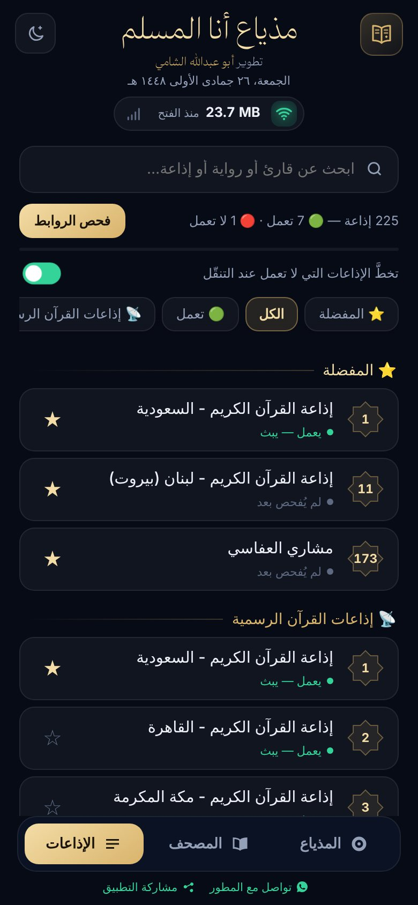 | 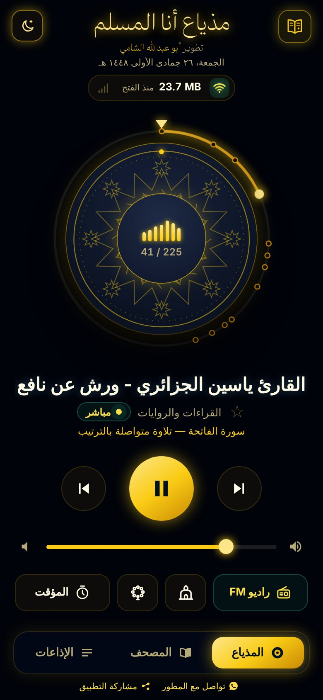 |

| فهرس المصحف | الاستماع مع تظليل الآية | المصحف الليلي |
|:---:|:---:|:---:|
| 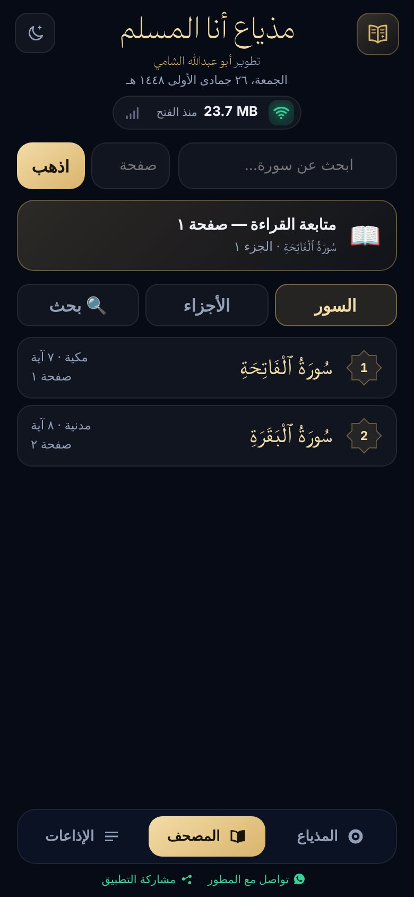 | 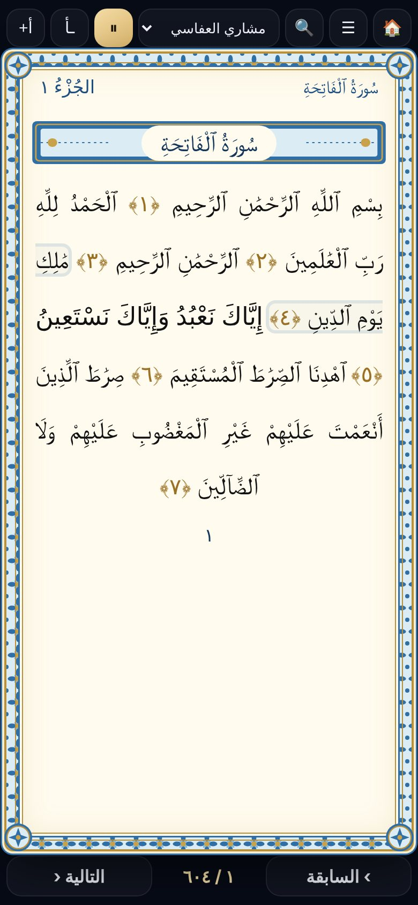 | 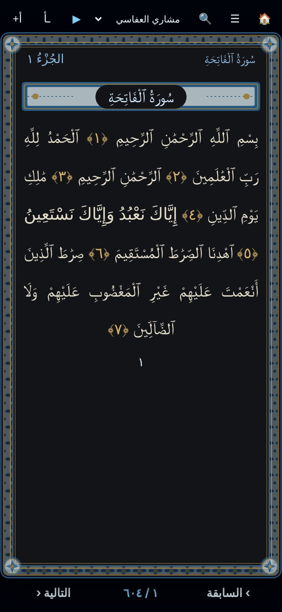 |

| البحث في القرآن | أوقات الصلاة | اتجاه القبلة |
|:---:|:---:|:---:|
| 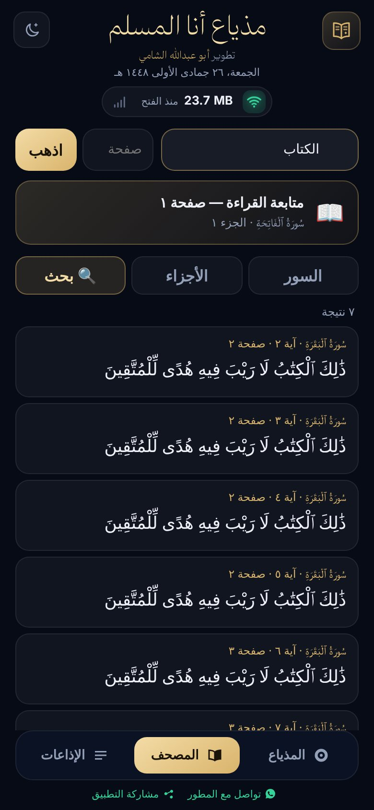 | 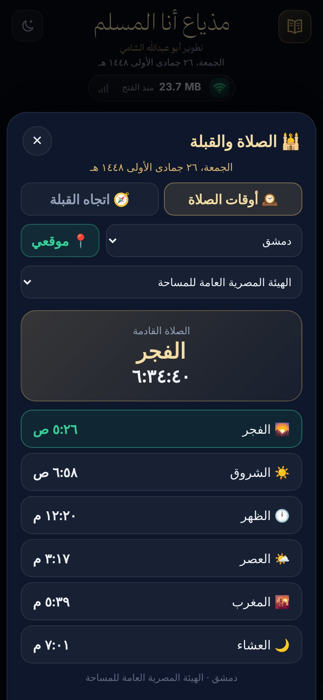 | 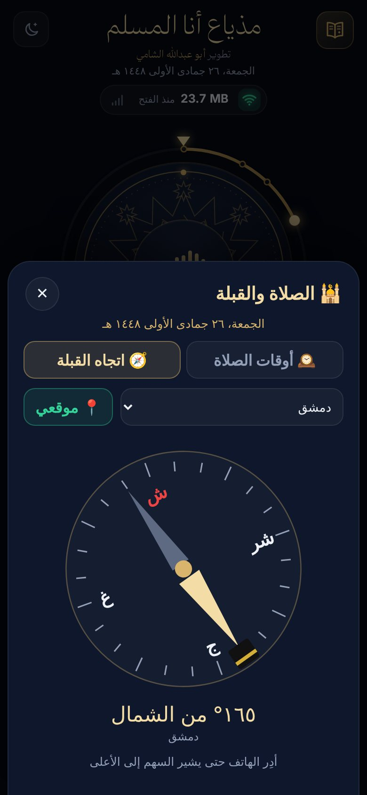 |

| الأذكار | اختيار المظهر | الوضع الليلي الأزرق |
|:---:|:---:|:---:|
| 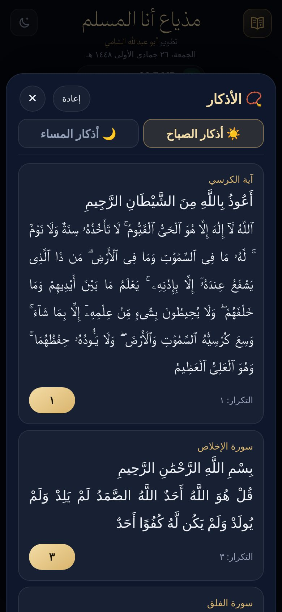 | 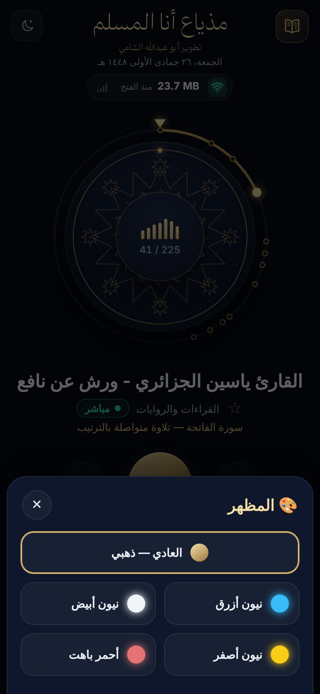 |  |

---

## 📥 التحميل

**[⬇️ تحميل أحدث نسخة](../../releases/latest)** — من صفحة الإصدارات (Releases)، والتطبيق يُعلمك تلقائياً عند صدور تحديث جديد.

أو اطلب التطبيق مباشرة من المطور عبر [واتساب](https://wa.me/963968744241?text=%D8%A7%D9%84%D8%B3%D9%84%D8%A7%D9%85%20%D8%B9%D9%84%D9%8A%D9%83%D9%85%D8%8C%20%D8%A3%D8%B1%D8%BA%D8%A8%20%D8%A8%D8%A7%D9%84%D8%AD%D8%B5%D9%88%D9%84%20%D8%B9%D9%84%D9%89%20%D8%AA%D8%B7%D8%A8%D9%8A%D9%82%20%C2%AB%D9%85%D8%B0%D9%8A%D8%A7%D8%B9%20%D8%A3%D9%86%D8%A7%20%D8%A7%D9%84%D9%85%D8%B3%D9%84%D9%85%C2%BB).

---

## 🛠️ للمطورين

| | |
|---|---|
| **الواجهة** | `app/src/main/assets/radio.html` (HTML/CSS/JS — تعمل أيضاً في المتصفح) |
| **التشغيل** | ExoPlayer (Media3) في خدمة خلفية مع MediaSession |
| **قائمة الإذاعات** | `app/src/main/assets/radios.json` |
| **البناء** | تلقائي عبر GitHub Actions (`.github/workflows/main.yml`) بمفتاح توقيع ثابت من أسرار المستودع |
| **أدنى إصدار** | Android 5.0 (API 21) |

### مصادر المحتوى
- إذاعات: [mp3quran.net](https://mp3quran.net) وإذاعات القرآن الرسمية والإذاعات الإسلامية العامة.
- نص المصحف: [alquran.cloud](https://alquran.cloud) (رواية حفص — الرسم العثماني).
- التلاوة آية آية: [everyayah.com](https://everyayah.com).
- الأذكار: كتاب «حصن المسلم».

---

**مذياع أنا المسلم** — تطوير أبو عبدالله الشامي

[تواصل مع المطور عبر واتساب](https://wa.me/963968744241)

اللهم اجعله صدقة جارية 🤲

